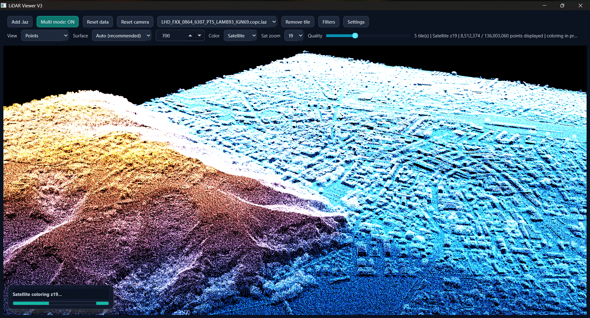
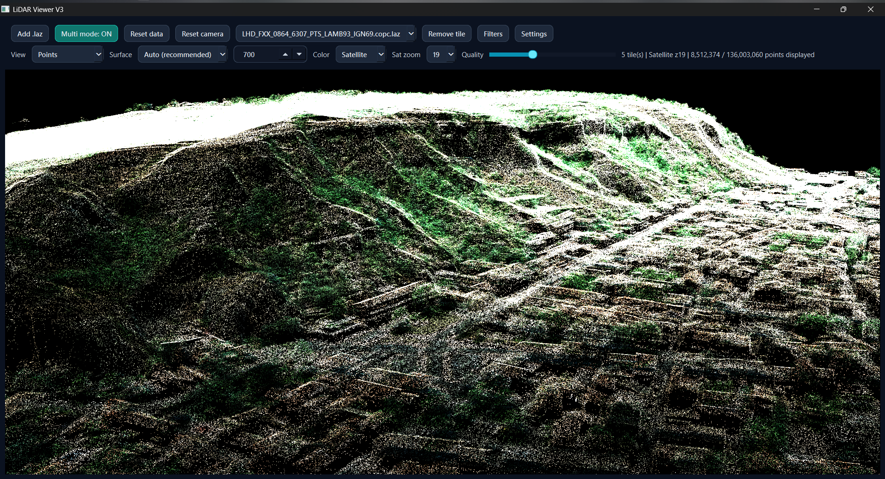
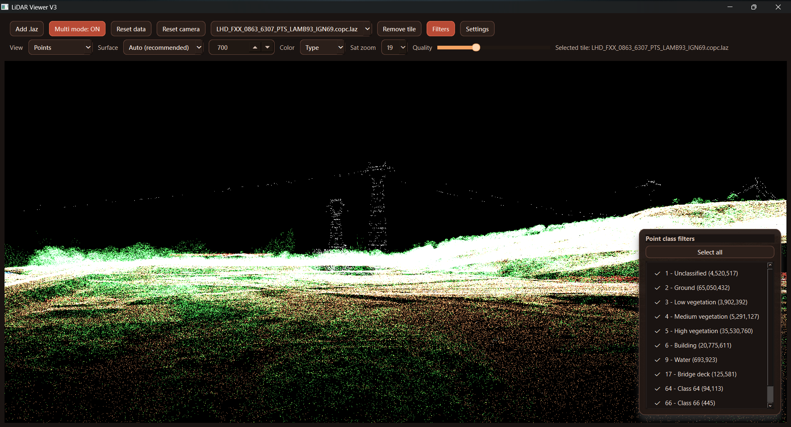

 <p align="center">
  
</p>

<h1 align="center">LiDAR View</h1>

<p align="center">
  <strong>Explore the world, point by point.</strong>
  <br>
  A desktop viewer for massive LiDAR point clouds, built for detailed 3D exploration.
</p>

<p align="center">
  
  
  
  
</p>

<p align="center">
  <a href="#-features">Features</a> ·
  <a href="#-preview">Preview</a> ·
  <a href="#-installation">Installation</a> ·
  <a href="#-controls">Controls</a> ·
  <a href="#-performance">Performance</a>
</p>

---

## ✦ Overview

**LiDAR View** is a desktop application for loading and exploring `.las` and `.laz` point clouds.

Designed for working with individual tiles or larger datasets, it combines interactive 3D navigation, level-of-detail rendering, satellite imagery projection, and terrain-like surface visualization in one interface.

Whether you're inspecting terrain, navigating geospatial datasets, or comparing classifications, LiDAR View gives you the tools to explore your data visually.

## ◈ Preview

<p align="center">
  
</p>

<p align="center">
  
  
</p>

<p align="center">
  <sub>Satellite projection · 3D terrain · Classification filtering</sub>
</p>

---

## ⚡ Features

<table>
  <tr>
    <td width="50%">
      <h3>◈ Multi-tile workflow</h3>
      Load individual tiles or append multiple datasets into one scene. Switch between replace and append modes while maintaining control over loaded data.
    </td>
    <td width="50%">
      <h3>⌁ Interactive 3D</h3>
      Navigate point clouds with camera controls, tile selection overlays, and adjustable rendering quality.
    </td>
  </tr>
  <tr>
    <td width="50%">
      <h3>◉ Multiple color modes</h3>
      <strong>Elevation</strong> for height-based visualization.<br>
      <strong>Satellite</strong> for projected aerial imagery.<br>
      <strong>Type</strong> for LAS classification colors.
    </td>
    <td width="50%">
      <h3>▦ Surface rendering</h3>
      Switch between raw points and opaque terrain-like surfaces, with automatic or manually controlled surface precision.
    </td>
  </tr>
  <tr>
    <td width="50%">
      <h3>⌘ Resource controls</h3>
      Configure per-tile point limits, global point budgets, level of detail, and concurrent loading workers.
    </td>
    <td width="50%">
      <h3>⚙ Custom interface</h3>
      Multiple themes, English and French languages, UI scaling, compact toolbar, and configurable popups.
    </td>
  </tr>
</table>

Additional capabilities include background processing, live LAS classification filters, tile overlays, coordinate decoding using scale and offset values, and rendering/cache refresh controls.

## ▸ Installation

### Requirements

- Python **3.10 or newer** — Python 3.11 or 3.12 recommended
- Windows, macOS, or Linux with OpenGL support
- Internet access for satellite imagery

### Quick start — Windows

Run the automated setup script from the repository directory:

```powershell
powershell -ExecutionPolicy Bypass -File .\install_and_verify.ps1
.\.venv\Scripts\Activate.ps1
python .\main.py
```

### Manual installation

Create a virtual environment:

```powershell
python -m venv .venv
.\.venv\Scripts\Activate.ps1
```

Install the dependencies and launch the application:

```powershell
python -m pip install --upgrade pip
python -m pip install -r requirements.txt
python .\main.py
```

> **Note:** The commands above use Windows PowerShell. On Linux or macOS, activate the virtual environment using the commands appropriate for your shell.

---

## ⌖ Controls

### Navigation

| Action | Control |
|---|---|
| Rotate camera | Left-click + drag |
| Zoom | Mouse wheel |
| Select nearest tile | `Shift` + left-click |

### Main toolbar

| Control | Purpose |
|---|---|
| `Load .laz (replace)` | Load a file and replace the current scene |
| `Multi mode` | Toggle between replace and append behavior |
| `Reset data` | Clear loaded data |
| `Refresh data` | Rebuild rendering and cache state |
| `View` | Switch between `Points` and `Opaque surface` |
| `Surface` | Choose automatic or manual surface precision |
| `Color` | Select `Elevation`, `Satellite`, or `Type` |
| `Filters` | Open classification filters |
| `Sat zoom` | Adjust satellite imagery zoom, levels 16–20 |
| `Quality` | Adjust level-of-detail density |
| `Settings` | Open interface and resource settings |

### Settings

- **Language:** English or French
- **Theme:** Midnight, Dawn, Volcanic, Forest, Blueprint, or Sandstone
- **UI scale & popup width:** Adjust interface density and popup sizing
- **Max points / tile:** Limit points loaded from each tile
- **Global points budget:** Control the total point budget across loaded tiles
- **Load workers:** Adjust concurrent loading; fewer workers can keep the interface more responsive
- **Compact toolbar:** Reduce toolbar density
- **Tile outlines:** Toggle tile borders and translucent area highlights

The selected tile is emphasized with a stronger accent border and area highlight. It can be selected through the tile selector or directly in the 3D view.

---

## ◉ Satellite imagery

Satellite coloring projects aerial imagery onto loaded point clouds using tile-based web imagery.

- Works best when all loaded tiles share a valid coordinate reference system (CRS).
- If the CRS is missing, the loader attempts inference using `EPSG:4326`, `EPSG:3857`, and `EPSG:2154`.
- `pyproj` is used when coordinate conversion is required.
- The default imagery source is Esri World Imagery.

Satellite mode requires internet access. If imagery is unavailable, check the network connection, CRS consistency, and `pyproj` installation.

---

## ⚡ Performance

LiDAR datasets can grow quickly. These settings help keep exploration responsive:

- Lower **Quality** when viewing large areas.
- Keep satellite zoom around **17–19** for a balance between detail and responsiveness.
- Prefer **Surface → Auto** unless manual precision is necessary.
- Append tiles progressively and check alignment before loading large batches.
- Reduce **Load workers** if loading affects UI responsiveness.
- Use **Compact toolbar** when screen space is limited.

LiDAR View stores tile points internally as `float32`, applies point limits and a global point budget, and prepares data in background threads. Large datasets can still cause temporary stalls during intensive processing.

Qt is configured for desktop OpenGL to favor dedicated GPU usage when available.

---

## ⌘ Project structure

| File | Responsibility |
|---|---|
| `main.py` | Main interface, rendering, asynchronous processing, satellite coloring, and surface generation |
| `lidar_loader.py` | LAZ loading, precision decoding, and CRS inference |
| `gl_viewer.py` | Legacy OpenGL fallback viewer |
| `test_laz.py` | Small local test script, if used |
| `requirements.txt` | Python dependencies |
| `install_and_verify.ps1` | Windows installation and environment verification |

The main application logic lives in `main.py`, while loading utilities are centralized in `lidar_loader.py`.

---

## ⛭ Troubleshooting

<details>
  <summary><strong>Satellite mode falls back or imagery does not appear</strong></summary>

  - Check that loaded tiles use a consistent CRS.
  - Ensure `pyproj` is installed when coordinate conversion is needed.
  - Verify internet access.
</details>

<details>
  <summary><strong>OpenGL errors or unstable surface rendering</strong></summary>

  - Update your graphics drivers.
  - Lower surface precision or switch to `Points`.
  - Test with a smaller area first.
</details>

<details>
  <summary><strong>Loading is slow or the interface temporarily stalls</strong></summary>

  - Lower rendering quality.
  - Reduce the number of concurrent loader workers.
  - Load tiles in smaller batches.
  - Remember that very large datasets can still require intensive processing.
</details>

---

## ◈ Development

- Keep loading utilities centralized in `lidar_loader.py`.
- Keep user-facing messages concise and actionable.
- Run `install_and_verify.ps1` before opening Windows-related issues.
- Preserve consistent formatting with `.editorconfig`.

Basic Python syntax check:

```bash
python -m py_compile main.py lidar_loader.py gl_viewer.py
```

For contribution guidelines, see [`CONTRIBUTING.md`](CONTRIBUTING.md).

---

## License

Distributed under the MIT License. See [`LICENSE`](LICENSE).

<p align="center">
  <sub>Built for exploring the world, one point at a time.</sub>
  <br>
  <strong><span style="color:#FF66C4">LiDAR</span> <span style="color:#A3E635">View</span></strong>
</p>
